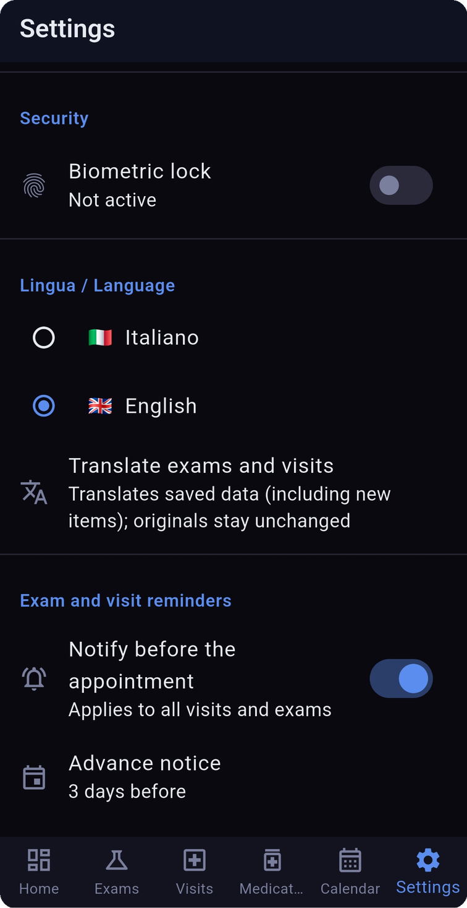

🇬🇧 [English version](README.md)

# Health Monitor

App per tenere sotto controllo la propria salute, fatta con **Flutter** (Android, supportato anche Windows).
Raccoglie in un posto solo esami del sangue, visite specialistiche, farmaci e appuntamenti, legge i dati
di bilancia e smartwatch/anello tramite **Health Connect** e usa l'**API di Claude** per analizzare i referti
e calcolare un punteggio di salute spiegabile.

> **Avviso:** è un progetto personale, non un dispositivo medico. Nulla nell'app è un consiglio medico.
> Rivolgiti sempre a un medico.

L'interfaccia è in **italiano 🇮🇹 e inglese 🇬🇧**, selezionabile in ogni momento da Impostazioni.

## 🖼️ Screenshot

Tutti gli screenshot usano dati demo di fantasia (paziente "John Smith") e mostrano l'interfaccia in inglese; l'app è disponibile anche in italiano.

| Dashboard | Esami | Calendario |
| --- | --- | --- |
| [](docs/screenshots/dashboard.png) | [](docs/screenshots/esami.png) | [](docs/screenshots/calendario.png) |
| Punteggio di salute, dati wearable e andamento esami | Esami dal più recente, con segnalazione dei valori fuori range | Appuntamenti con costi e promemoria |

| Statistiche | Impostazioni |
| --- | --- |
| [](docs/screenshots/statistiche.png) | [](docs/screenshots/impostazioni.png) |
| Visite, esami e spese per anno | Lingua, sicurezza, promemoria, archiviazione e backup |

## 📱 Installare l'app (senza compilare nulla)

Serve un telefono **Android 8.0 o superiore**.

### 1. Scarica l'APK

Apri dal telefono la pagina delle versioni e scarica il file `.apk` più recente:

👉 **https://github.com/federico-bettin/health-monitor/releases/latest**

### 2. Installa

1. Tocca il file scaricato (lo trovi nelle notifiche o nell'app **File → Download**).
2. Android ti chiederà di consentire l'installazione da **fonti sconosciute** per il browser (o per l'app File che stai usando): tocca **Impostazioni** e attiva **Consenti da questa fonte**, poi torna indietro.
3. Se compare l'avviso di **Play Protect** ("app non verificata"), tocca **Altri dettagli → Installa comunque**. L'avviso compare perché l'app non è sul Play Store, non perché contenga qualcosa di pericoloso: il codice è tutto pubblico qui sopra.
4. Tocca **Installa**, poi **Apri**.

Finita l'installazione puoi disattivare di nuovo "fonti sconosciute".

### 3. Primo avvio

- **Health Connect:** su **Android 14 o superiore** è già integrato nel sistema. Su Android 13 o precedente installa prima l'app **Health Connect** dal Play Store. L'app ti chiederà i permessi di lettura (peso, battito, passi, sonno…): concedili solo per i dati che vuoi usare.
- **Lingua:** cambiala in **Impostazioni** se vuoi.
- **Blocco biometrico** (facoltativo): si attiva sempre da Impostazioni.

### 4. Funzioni con e senza chiave API di Claude

L'app funziona anche **senza** nessuna chiave. La chiave serve solo per le funzioni di intelligenza artificiale.

| Funzione | Senza chiave | Con chiave Claude |
| --- | :---: | :---: |
| Esami, visite, farmaci, calendario, promemoria | ✅ | ✅ |
| Grafici con range verde / arancio / rosso | ✅ | ✅ |
| Dati da bilancia e anello (Health Connect) | ✅ | ✅ |
| Statistiche e costi per anno | ✅ | ✅ |
| Backup e ripristino, sync Google Drive | ✅ | ✅ |
| Importazione automatica dei referti PDF / foto | ❌ (inserimento manuale) | ✅ |
| Analisi AI e commento del punteggio di salute | ❌ | ✅ |

**Come ottenere e inserire la chiave** (facoltativo):

1. Crea un account su <https://console.anthropic.com> e genera una chiave API (l'uso è a pagamento, a consumo: con il modello Haiku, il più economico, una analisi costa pochi centesimi).
2. Nell'app vai in **Impostazioni** e incolla la chiave nel campo dedicato.
3. La chiave resta sul **tuo telefono** e non viene condivisa con nessuno.

> ⚠️ **Privacy:** quando usi le funzioni AI, il testo o l'immagine del documento che importi viene inviato alle API di Anthropic. Senza chiave non viene inviato niente.

### 5. Google Drive (facoltativo)

Il sync con Google Drive salva una copia dei dati sul **tuo** Drive. Per ora l'accesso con Google è limitato agli account autorizzati dall'autore, quindi **potrebbe non funzionare per il tuo account**. Per fare copie di sicurezza puoi usare **Impostazioni → Backup e ripristino**, che salva un file JSON sul telefono e non richiede Google.

## ✨ Funzioni

### Dashboard
- **Punteggio di salute (1–10)** con titolo breve. Toccandolo si apre l'analisi completa: sintesi, confronto con la media italiana per fascia d'età, punti di forza, aree di attenzione, tre miglioramenti concreti ed esami consigliati.
- **Contatori rapidi** per esami, visite, farmaci attivi e appuntamenti.
- **Dati wearable:** passi di oggi, battito e sonno, con pagina di dettaglio per ciascuno.
- **Andamento esami:** scegli una categoria (glicemia, lipidi, vitamine, emocromo…) e un valore per vederne la storia. Le categorie con valori fuori range vengono per prime.

### Esami
- Qualsiasi numero di valori con unità e range di riferimento, laboratorio, medico e note.
- **Grafici a colori:** verde = nel range, arancio = fuori fino al 20 %, rosso = fuori oltre il 20 %.
- **Nomi normalizzati** (es. "LDL" e "colesterolo LDL" sono lo stesso valore), così gli andamenti restano continui anche se i laboratori usano nomi diversi.
- Il **PDF o la foto** del referto originale si allega e si riapre dal dettaglio.
- Elenchi sempre dal più recente al più vecchio.

### Visite
- Specialità, medico, struttura, diagnosi, terapia, farmaci prescritti, note e documento originale.

### Farmaci
- Farmaci attivi e passati con dose, frequenza, principio attivo, medico prescrittore e orari di assunzione.

### Importazione documenti con AI *(richiede chiave API)*
- Importa uno o **più PDF insieme** (o una foto) di un referto.
- Claude legge il documento e compila il modulo: tipo, data, valori con unità e range, diagnosi, terapia. Tu controlli e confermi prima di salvare.

### Punteggio di salute
- Calcolato da età, BMI, stile di vita (fumo, alcol, passi), **ultimo valore per ogni tipo di esame**, **ultima visita per specialità**, patologie croniche e sonno.
- Usa una **rubrica fissa** (si parte da 10 e si applicano penalità fisse): gli stessi dati danno sempre lo stesso punteggio.
- Si aggiorna **automaticamente** quando salvi un esame o una visita, **manualmente** con il pulsante di aggiornamento, e mai solo perché cambiano i dati del wearable.

### Wearable (Health Connect)
- Legge peso, grasso corporeo, massa magra, acqua, battito, passi, sonno (profondo / REM) e calorie attive.
- Provato con bilancia e anello Amazfit / Zepp; funziona con qualsiasi app che scrive su Health Connect.
- Gestisce le stranezze dei dati reali: i passi incrementali vengono sommati per giorno, le sorgenti non vengono mai mescolate.

### Calendario, costi e statistiche
- Appuntamenti con data, ora, medico, struttura e **costo in euro** facoltativo.
- **Statistiche per anno:** numero di visite ed esami, spesa totale ed elenco con i costi.
- **Promemoria** (default: 3 giorni prima, alle 09:00), configurabili; arrivano anche ad app chiusa.

### Profilo, dati e sicurezza
- Dati personali, altezza, peso, anamnesi, patologie croniche, stile di vita, **più profili paziente** sullo stesso dispositivo.
- Archiviazione: solo dispositivo, Google Drive, oppure entrambi. Backup e ripristino manuali in JSON.
- **Blocco biometrico** (impronta / volto). I dati restano sul dispositivo, a meno che tu non attivi Google Drive.

### Modello AI
- Scegli il modello Claude in Impostazioni: **Haiku 4.5** (predefinito, il più economico), **Sonnet 4.6** o **Opus 4.6**.
- Schermata con **consumo di token** e costo stimato.

## 🛠️ Per sviluppatori: compilare da sorgente

Requisiti: Flutter SDK, Android SDK (minSdk 26), un dispositivo o emulatore Android.

```
flutter pub get
cp lib/core/constants.template.dart lib/core/constants.dart
flutter run
```

Build di rilascio: `flutter build apk --release`.
Dettagli su Google Drive, architettura e stack tecnico nel [README inglese](README.md).

## 🔒 Privacy

- I dati restano sul dispositivo, a meno che tu non attivi Google Drive.
- Con le funzioni AI il documento che importi viene inviato alle API di Anthropic.
- Il repository non contiene dati personali, chiavi o credenziali.

## Licenza

MIT, vedi [LICENSE](LICENSE).

## Autore

Federico Bettin, ingegnere software (embedded, automazione industriale, sistemi safety-critical).
