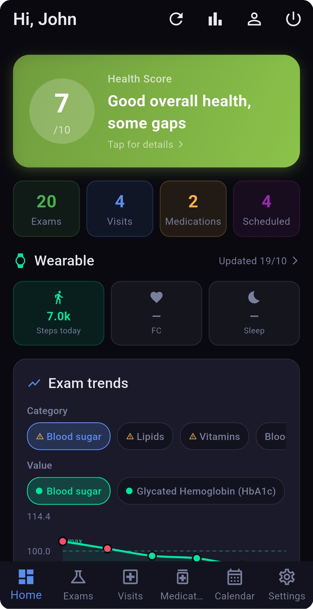
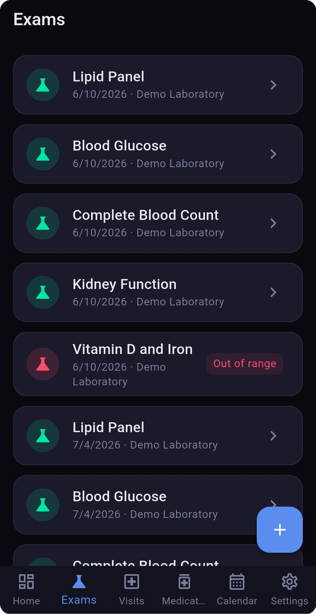
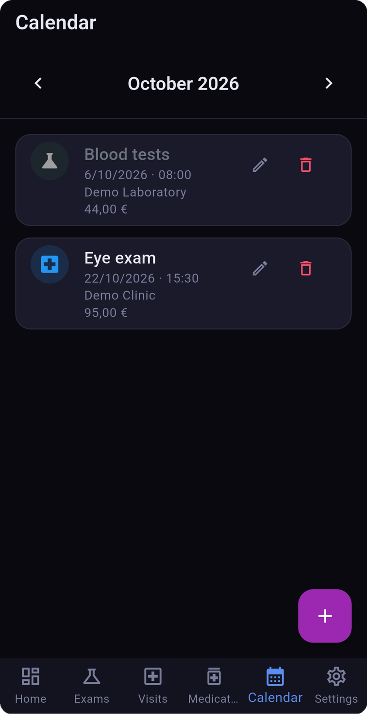
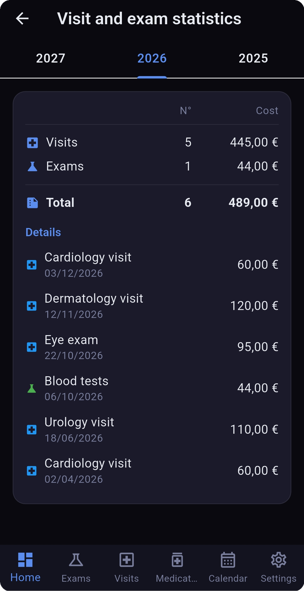

# Health Monitor

A personal health-tracking app built with **Flutter** (Android first, Windows supported).
It keeps lab results, specialist visits, medications and appointments in one place,
reads wearable data through **Health Connect**, and uses the **Claude API** to
analyse medical documents and produce an explainable health score.

> **Disclaimer:** this is a personal project, not a medical device. Nothing in the
> app is medical advice. Always consult a qualified healthcare professional.

The user interface is in Italian.

## Screenshots

All screenshots use fictional demo data (see [Demo data](#demo-data)).

| Dashboard | Lab results | Calendar | Statistics |
|---|---|---|---|
|  |  |  |  |

## Features

- **Lab results** with reference ranges, colour-coded charts over time (in range / slightly out / out of range) and normalised exam names.
- **Visits, medications and documents**, including PDF and image import.
- **AI document analysis:** import a lab report or a visit report and let Claude extract the values.
- **Health score (1–10)** computed from BMI, lifestyle, latest results per exam type, chronic conditions and wearable data, with a fixed scoring rubric and a comparison against Italian population averages. It refreshes automatically when new exams or visits are added.
- **Wearables via Health Connect:** weight/body composition (smart scale) and activity, heart rate and sleep (smart ring). Handles source filtering and incremental step records.
- **Calendar with costs:** appointments for visits and exams, with an optional cost in euros.
- **Statistics per year:** number of visits and exams and total spending, with the list of each item and its cost.
- **Reminders:** a single notification rule for all visits and exams (default: 3 days before at 09:00), configurable in Settings.
- **Multiple patient profiles**, biometric lock, local backup/restore and Google Drive backup.
- **Storage modes:** device only, Google Drive, or device + Drive.

## Tech stack

| Area | Choice |
|---|---|
| UI / state / routing | Flutter, Riverpod, GoRouter |
| Local storage | Hive |
| Cloud | Google Sign-In, Google Drive API |
| Charts | fl_chart |
| Wearables | `health` package (Health Connect) |
| AI | Anthropic Claude API (Haiku / Sonnet / Opus selectable) |
| Notifications | flutter_local_notifications |

## Architecture

All data access goes through a single `IDataRepository` interface, resolved at runtime
by a Riverpod provider based on the storage mode chosen in Settings:

```
UI (pages)  ->  repositoryProvider  ->  IDataRepository
                                          |- LocalRepository  (Hive)
                                          |- DriveRepository  (JSON on the user's Drive)
                                          |- SyncRepository   (local + Drive)
```

Pages never instantiate a concrete repository, so storage can be changed without touching the UI.
Models are Hive objects with JSON (de)serialisation for backup and Drive. Data written by
earlier versions stays readable because new fields are nullable.

## Getting started

Requirements: Flutter SDK, Android SDK (minSdk 26), an Android device or emulator.

1. Clone the repository and install dependencies:
   ```bash
   flutter pub get
   ```
2. Create your local configuration (this file is git-ignored):
   ```bash
   cp lib/core/constants.template.dart lib/core/constants.dart
   ```
   Open `lib/core/constants.dart` and set your own Anthropic API key
   (<https://console.anthropic.com>). **Never commit this file.**
3. *(Only for Google Drive features)* create a Google Cloud / Firebase project, enable the
   Drive API, register an Android OAuth client for the package name and your debug SHA-1, and
   place `google-services.json` in `android/app/` (also git-ignored). If you fork the project,
   change the application id in `android/app/build.gradle.kts`.
4. Generate the Hive adapters if you change a model:
   ```bash
   dart run build_runner build --delete-conflicting-outputs
   ```
5. Run it:
   ```bash
   flutter run
   ```

Release build: `flutter build apk --release`.

### A note on the API key

The key lives in `constants.dart` and is compiled into the app, so it can be extracted from
an APK. This is fine for personal use. A public distribution should have each user enter
their own key, or route calls through a backend that holds it.

## Demo data

`docs/health_monitor_demo_backup.json` contains a fictional patient (Mario Rossi) with lab
results, visits, a medication and appointments with costs, useful for trying the app or taking
screenshots. Copy it to the device's backup folder (Documents) and use
**Settings -> Backup and restore -> Restore**.
Restoring **replaces** the data currently in the app, so use a test device or make a backup first.

## Privacy

- Data stays on the device unless you enable Google Drive.
- When you use AI features, the text or image of the document you submit is sent to the Anthropic API.
- The repository contains no personal data, keys or credentials.

## Roadmap

- Full offline-first sync with Drive (per-record merge) and report PDF upload
- Per-user API key entry in Settings
- Export of yearly statistics

## License

MIT - see [LICENSE](LICENSE).

## Author

Federico Bettin - software engineer (embedded, industrial automation, safety-critical systems).
